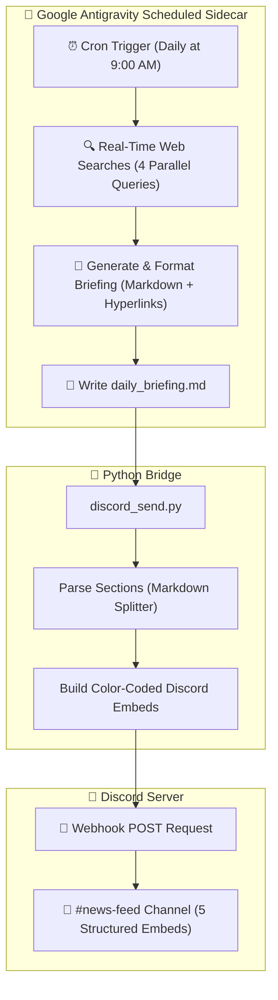

# AI Daily News Intelligence Agent

An autonomous AI news intelligence agent and scheduled briefing system built with **Google Antigravity**, **Python**, and **Discord Webhooks**.

Every morning, the agent searches the live web for the latest real-time developments across four targeted sectors, compiles an executive briefing with clickable source links, and delivers rich, color-coded embed cards directly to a designated Discord channel.

---

## News Coverage Areas

1. 🔒 **Cybersecurity**: Zero-day vulnerabilities, active exploits, CISA KEV advisories, threat actor campaigns, and enterprise breach intelligence.
2. 📈 **Stock Market & Finance**: Real-time market snapshot (S&P 500, Dow Jones, NASDAQ), tech & semiconductor movers, commodities, Treasury yields, and macro commentary.
3. 🌍 **General World News**: Key diplomatic negotiations, geopolitical conflicts, international summits (e.g., COP climate summits), and global health reports.
4. 🇳🇵 **Nepal News**: High-altitude climate advocacy ("Mountain Agenda"), disaster recovery & rebuilding initiatives, domestic policy, economic updates, and national sports.
5. 🔑 **Executive Key Takeaway**: A synthesis paragraph highlighting the single most critical cross-sector event and its broader market/strategic implications.

---

## 🏛️ System Architecture



---

## 📁 Repository Structure

```
.
├── .env.example            # Environment variables template
├── .gitignore              # Ignores secrets, caches, and daily briefing outputs
├── sidecar.json            # Antigravity automation configuration & schedule
├── requirements.txt        # Python package dependencies
├── discord_send.py         # Parses markdown briefing & delivers Discord embeds
├── discord_news_bot.py     # Standalone news bot test runner
└── README.md               # Complete documentation
```

---

## 🚀 Getting Started

### 1. Prerequisites
- Python 3.9+
- A Discord server where you have permission to manage Webhooks
- [Google Antigravity](https://antigravity.google) (for scheduled automation)

### 2. Installation

Clone this repository and install dependencies:

```bash
git clone https://github.com/<your-username>/<repo-name>.git
cd <repo-name>
pip install -r requirements.txt
```

### 3. Discord Webhook Setup

1. Open your Discord server and navigate to the channel where you want briefings delivered (e.g., `#news-feed`).
2. Click the **⚙️ Edit Channel** gear icon.
3. Select **Integrations** → **Webhooks** → **New Webhook**.
4. Name the webhook (e.g., `📰 Daily News Briefing`).
5. Click **Copy Webhook URL**.
6. Create a `.env` file in the project root:

```bash
cp .env.example .env
```

7. Open `.env` and paste your webhook URL:

```env
DISCORD_WEBHOOK_URL=https://discord.com/api/webhooks/YOUR_WEBHOOK_ID/YOUR_WEBHOOK_TOKEN
```

---

## ⚙️ Running Manually

You can test the Discord sender at any time using a sample markdown briefing:

```bash
# Test with a markdown file
python discord_send.py path/to/briefing.md

# Or run the standalone bot test script
python discord_news_bot.py
```

---

## ⏰ Automated Scheduling with Antigravity

This repository includes `sidecar.json`, a configuration file for the Google Antigravity Sidecar Automation engine.

### How It Works:
- **Engine**: Antigravity Sidecar (`"builtin": "schedule"`)
- **Schedule**: `CRON_TZ=America/New_York 0 9 * * *` (9:00 AM daily)
- **Permissions Required**:
  - `search_web`: Allows the agent to query real-time web news.
  - `write_file`: Allows writing the compiled `daily_briefing.md`.
  - `command`: Allows executing `python discord_send.py`.

### Deploying the Sidecar:
1. Place `sidecar.json` into your Antigravity config directory:
   ```
   ~/.gemini/config/sidecars/daily-news-briefing/sidecar.json
   ```
2. Open the Antigravity Automations Dashboard.
3. Toggle **Daily News Briefing** to **Enabled**.

The agent will run silently in the background every morning and deliver the report straight to Discord.

---

## 🎨 Discord Embed Colors

Each section is assigned a distinct embed color:

| Section | Color | Hex Code |
|---|---|---|
| 🔒 Cybersecurity | Crimson Red | `#E74C3C` |
| 📈 Stock Market | Emerald Green | `#2ECC71` |
| 🌍 World News | Royal Blue | `#3498DB` |
| 🇳🇵 Nepal News | Mountain Teal | `#1ABC9C` |
| 🔑 Key Takeaway | Golden Yellow | `#F1C40F` |

---

## 🛡️ Security Best Practices
- Never commit your `.env` file or raw webhook URLs to GitHub.
- If your Discord Webhook URL is ever exposed publicly, delete it in Discord channel settings immediately and generate a new one.

---

## 📄 License
This project is open-source and available under the [MIT License](LICENSE).
